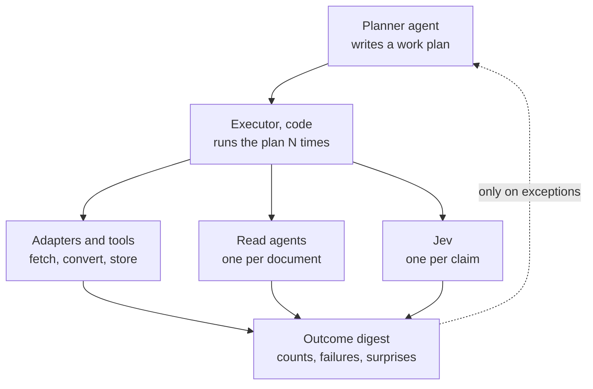

# Agent-first design for the successor to car-surveyor

Written 2026-11-17. This is the founding design for a **new repository**
that succeeds car-surveyor. It is written here so it can be reviewed
before the new repository exists; it moves there as its first commit.
car-surveyor is kept as the record of the code-first approach.

> **Agents: the isolation rules below hold in the new repository from its
> first commit.** Never read `~/refdata/` or any copy of the OpenSpec
> data, never fetch `visor.vin` or its subdomains, never search the web
> for OpenSpec data, and never ask for a reference value.

## Why a new approach

car-surveyor puts the intelligence in code and uses a model only to point
at table cells. That made it cumbersome, and it did not pay off:

- **Discovery is hardcoded per site.** It reads Toyota's sitemap and sorts
  PDFs by words in their file names. A second make means a second
  discovery module.
- **The locator check rejects correct values.** On spec sheets, Haiku
  returned 80% of the figures Opus returned, and verification rejected
  756 of its 1,087 values, mostly for the shape of the locator (an empty
  column header, a row label run into the cell), not for a wrong number
  ([comparison](../findings/2026-11-16-haiku-vs-opus-extraction.md)).
- **An agent reads every document anyway.** Spec sheets already go to
  Claude Code through export and import files, outside the pipeline.

The new approach gives agents the work that needs judgment, gives code
the work that is mechanical, and moves work from the first to the second
as it is seen to be mechanical.

## Scope of the first milestone

The design is for many makes and markets. The first milestone is
deliberately small: **one make, one market, one model year**, run
headless end to end, on a make car-surveyor never covered (Honda, US, is
the default). Toyota, US, follows, because car-surveyor's catalogue and
its diff give a known baseline.

Columns stay those of car-surveyor v0: styles, MSRP with the delivery fee,
horsepower, torque, and city, highway and combined mpg. Mapping into a
full schema is designed in a separate session (see [Open](#open)).

## Principles

1. **Agents decide what to do; code does it, as often as needed. The
   hand-off is a file.** Deciding what the list of work is (which
   sources, which years, which documents are worth reading, what to do
   when a class of fetches fails) is judgment, and rare. Working through
   the list is mechanical, and happens N times. A planner agent writes a
   declarative work plan; code executes it
   ([Planning and execution](#planning-and-execution)). No agent
   iterates over a list it was given, retries a fetch, or keeps
   bookkeeping.
2. **Agents where judgment is needed, code everywhere else.** Agents
   plan, survey, probe, score, read documents and adjudicate. Fetching,
   storing, converting, checking and counting are code. Every agent
   writes data (a source card, a work plan, claims), never actions for
   code to replay.
3. **Promote what repeats.** A step an agent does by hand twice, with no
   judgment in it, becomes a tool, an adapter or a skill
   ([Promotion](#promotion)).
4. **Every value has a full provenance chain**: document, quote, the
   agent that read it, and every verdict on it.
5. **Every claim is verified by a second model**, and doubts escalate
   ([Verification](#verification)).
6. **Nothing invented, nothing overwritten.** A null means no source
   stated the value, and `unstated` is never replaced by a default.
   Disagreeing values are all kept.
7. **Probe before depending** on any site, API or model.
8. **Isolation from the first commit** ([Isolation](#isolation)).

## Layers

| Layer | Is | Holds |
|---|---|---|
| Agents | headless Claude Code runs, one per unit of work | the judgment: what a source is, what a document says |
| Skills | `SKILL.md` files the agents load | know-how: procedures, and notes on each site |
| Toolbox | a Python package and its CLI, `cs` | mechanical steps: fetch, store, convert, record, verify |
| Adapters | per-site code in the toolbox | mechanical steps that only make sense for one site |
| Planner | a headless agent, run per make and market | the work plan, and the response to exceptions |
| Executor | plain code | runs the work plan: the loop, the queue of units, budgets, the run ledger, the outcome digest |
| Store | a database plus content-addressed files | sources, plans, snapshots, claims, verdicts, runs |

Agents are Claude Code, run headless (`claude -p` with `stream-json`
output, or the Claude Agent SDK; the choice is a probe in step A0).
Interactive sessions are for developing the system, not for producing
data.

## Planning and execution

**The planner** is an agent. It reads the approved source cards for a
make and market, and the last digest if there is one, and writes a
**work plan**: a file listing the sources to use, the years, the listing
pages and the adapter for each, which document kinds to read and which
to skip, and the budget. It does not fetch in a loop or read documents.

**The executor** is code. It validates the plan, expands it into units,
runs them (adapters and tools directly, read agents one per document,
Jev one per claim), and writes the run ledger.

**The outcome digest** is code's summary of a run, not its raw results:
counts per source and unit, failures grouped by cause (nine 403s from
one host), documents a read skill did not expect, and Jev's escalation
rate. The planner is called again only when the digest shows something
outside the plan's expectations. Its context therefore stays small
however many documents there are.

Work plans are files, so they are reviewed like source cards, compared
with last month's, and re-run without an agent.

**Fan-out inside an agent** is allowed when choosing the branches is the
judgment: a survey agent may start Claude Code subagents to look at a
make's newsroom, its government data and the archives. Fan-out over a
list that already exists (the 200 documents a plan names) is the
executor's.

**Why not an orchestrator agent.** An agent that calls a subagent per
document reads every result into its context and re-reads it on every
turn. Its cost grows faster than the number of documents, it waits on a
model turn for each step, and long lists are where agents drift or skip
items. A loop in code costs no tokens. Its one weakness, a plan fixed in
code, is what the planner removes.

## Units of work

| Unit | Granularity | Done by | Produces |
|---|---|---|---|
| Plan | per make and market, and on exceptions | planner agent | a work plan |
| Survey | per make and market | agent | source cards |
| Probe | per source | agent, then adapter once one exists | probe results on the card: fields, years, access route, layout, counts |
| Score | per source | agent, plus measured agreement from code | a score and its reasons on the card |
| Harvest | per source and year | adapter or tool; agent only as fallback | snapshots |
| Read | per document | agent | claims |
| Verify | per claim | code gate, then Jev, then escalation | verdicts |
| Adjudicate | per contested value | agent | a decision with reasons |
| Assemble | per make, market and year | code | the catalogue views |

Plan, survey, probe and score are rare: once per make and market, redone
when a site changes or a digest shows an exception. Read is the one
agent unit that scales with the data.

## Sources

A **source card** is one YAML file per source, written by the survey
agent, reviewed by a person before the source is used:

- name, owner, hosts, and the route to its documents (`direct`,
  `archive`, `manual`)
- kind: OEM pricing document, OEM specification document, OEM press
  release, government data, archive copy; aggregators are recorded but
  never used
- probe results: which columns it carries, which years, how many
  documents, a dated sample of each document type
- score: primacy, whether its documents are dated, coverage, stability
  of access, and later the agreement rate code measures against other
  sources
- the adapter and skills that serve it, once they exist

The fetcher refuses any host that no approved card lists.

## Snapshots

Carried over from car-surveyor: each document is fetched once and kept
by its SHA-256, with its URL, fetch date, archive capture date if any,
and the text and tables derived from it. Documents are never cleaned in
place. Polite fetching carries over as well: a named user agent, each
site's crawl delay, a pause after HTTP 429, and never imitating a
browser.

## Claims

A read agent records each value with `cs claim add`. A claim holds:

- the snapshot hash, page and a quote copied from the document
- the style it applies to, in the document's own words and split into
  parts (model, grade, body, engine, transmission, drive), or the scope
  a figure applies to when it covers several styles
- the attribute, the value as printed, the value as a number and its
  unit, hedges (`estimated`, `up to`), qualifiers (whether an MSRP
  includes the delivery fee) and an effective date
- the agent run that made it

`cs claim add` refuses a claim that does not fit the schema, or whose
quote is not in the snapshot's text. That is the only locating code
kept: there are no table-cell locators.

## Verification

Every claim goes up a ladder until a tier settles it. Every verdict is
stored with its tier, model, version and reason.

| Tier | Who | Gets | Settles |
|---|---|---|---|
| 0. Gate | code, in `cs claim add` | the claim and the snapshot text | schema errors and quotes not in the document: rejected |
| 1. Check | Jev, on every claim | the claim and an excerpt around the quote | `supported` is admitted; `unsupported` and `uncertain` go up |
| 2. Escalation | a stronger model (Sonnet or Opus) | the claim, the full page and the document's other claims | confirms, rejects, or corrects with a new quote |
| 3. Contested | recorded, not settled | both verdicts | waits for adjudication |

A corrected claim is a new claim and starts again at tier 0; a fix never
skips the cheap checks. Contested values are settled later by
strategies added as they are needed: other sources, an agent reading
both documents side by side, a person's review queue.

**Jev is measured before it is trusted.** A seeded set of claims, real
ones and ones with a wrong row, a wrong grade, a changed digit or a
number not printed, gives its rate of passing bad claims. That set is
also the regression test for every change of prompt or model at tier 1.
Jev's API, input limits, output (label or score), rate limits and price
are probed in A0.

## Promotion

The goal is that the second make costs less than the first, and the
tenth much less than the second. Agents stay where the work needs
judgment; everything else moves into code.

### What a step can become

| Becomes | When the repeated work is | Example |
|---|---|---|
| Skill | knowledge or a procedure the agent had to work out | "Toyota's PDFs sit on a host that refuses non-browser clients; use Wayback `id_` captures"; how to read a price sheet |
| Tool | deterministic and useful across sites | `cs fetch`, `cs wayback captures <url>`, `cs pdf tables <hash>` |
| Adapter | deterministic and specific to one site | list every price sheet on a pressroom for a range of years |
| Stage | a whole agent unit that turned out mechanical for one source | fueleconomy.gov's CSV read by a parser, with no agent |

Reading documents stays with agents by default. A stage is for sources
that are structured data already.

### How repeated work is found

1. **Friction log.** Every agent ends its run with a structured report:
   steps done by hand that a tool could have done, with their inputs and
   outputs; knowledge it had to work out; tools that failed or were
   missing; and whether it did anything a listed tool already does.
2. **Transcript mining.** Code reads each run's `stream-json` transcript
   and records tokens, cost, time and tool calls per phase, and flags
   repeated command patterns across runs (the same fetch-and-convert
   pipeline, the same listing page fetched every run).

3. **Plans and digests.** A planner that writes the same plan for a
   source every time shows that the plan belongs in the adapter as its
   default. A digest that shows the same exception run after run shows
   an adapter or skill to repair.

All three feed the **promotion queue**: candidates with their evidence, how
often they happened, what they cost, and in which runs.

### Who promotes

Worker agents never change the toolbox or skills during a run; that
would make runs irreproducible and parallel workers would collide.

A **toolsmith** session, run on demand or after a batch, reads the
queue, writes the tool, adapter or skill with tests, and opens a pull
request. A person reviews and merges it. A candidate is promoted when it
was seen in two or more runs, it is deterministic (same inputs, same
outputs, no judgment), and its expected future cost as agent work
clearly exceeds the cost of building it. Work that needed judgment
becomes a skill, never code.

### Agents are the fallback

When an adapter fails, because a site changed or a document is new, the
executor gives that unit to an agent together with the adapter's
error. The agent finishes the unit by hand and logs the failure as
friction; the toolsmith repairs the adapter. The pipeline slows down
instead of stopping.

### Making sure agents use what exists

- A source card names its adapter and skills, and the executor puts
  them in the agent's prompt.
- `cs tools` lists the toolbox, and the workers' instructions say to
  check it before doing anything by hand.
- A friction report that says "I did something a listed tool does" is a
  bug in a prompt or a tool, and is treated as one.

### Measuring it

The run ledger records, per run: unit, agent tokens, cost, wall time,
tool calls by kind, and the git commit of the toolbox and skills used.
The figures to watch are **cost per make and market** for survey, probe
and score, and **cost per document** for read and verify. Both should
fall as the toolbox grows; if they do not, promotion is not working.

## Provenance

Each admitted value traces to:

- the source card and its score
- the snapshot: hash, URL, fetch date, capture date
- the quote and page
- the read agent's run: model, prompt and skill versions, toolbox commit
- every verdict: tier, model, version, reason
- the adjudication, if there was one

## Isolation

Set up in step A0, before any agent runs, and tested before every batch.

1. **Sandbox.** The repository's settings deny network access to
   `visor.vin` and `*.visor.vin` and deny reading `~/refdata/`. Headless
   runs are started with these settings explicitly, and cannot run
   without them.
2. **Hook.** A PreToolUse hook blocks web searches and fetches that name
   OpenSpec or Visor, and fetches of repositories or mirrors of the
   OpenSpec bundle.
3. **Survey rule.** Aggregators, review sites and dealer listings are
   recorded on cards as not used, and never read for values or for
   which styles exist.
4. **Test.** `isolation-test` exits 0 only when a run cannot reach the
   reference. It runs in CI and before every batch.
5. **Comparison** with OpenSpec stays a plain script the user runs, as
   in car-surveyor. Agents see only its coarse feedback.
6. **Every fix to a value rests on a primary document**, named in the
   commit or the adjudication record.

## What carries over from car-surveyor

| Carried over | Rewritten or dropped |
|---|---|
| the fetcher: polite, host-checked, Wayback route | discovery by sitemap and file name: becomes survey plus adapters |
| the snapshot store and document derivation | extraction prompts and the API extractor: become read agents and skills |
| the isolation guard and its test | table-cell locators and per-claim rules: replaced by the quote gate and the ladder |
| the diff script and its feedback contract | resolution's hand-written inference rules: revisited in the schema session |
| what the probes learned, as site notes for skills | |

## Steps

| Step | Builds | Gate |
|---|---|---|
| A0 | repository, isolation, toolbox core (`cs fetch`, store, `cs claim add`), probes of Jev and of the headless runner | `isolation-test` passes; Jev and the runner each have a probe with a yes or no and figures |
| A1 | survey, probe and score agents; source cards for the first make | every source used has an approved card |
| A2 | the planner, the executor and the outcome digest; read agents and the verification ladder on one model year; the run ledger | every value traces to a document; Jev's rate of passing bad claims is measured |
| A3 | friction logs, transcript mining, plan and digest comparison, the promotion queue, the first toolsmith pass | a second run of the same slice costs less than the first |
| A4 | a second make and market | its cost per document is below the first make's |

## Open

1. **Schema.** How claims map into the catalogue's schema, and how
   styles are matched across documents. A separate session.
2. **Jev.** Its API and limits, probed in A0.
3. **Runner.** `claude -p` or the Claude Agent SDK, chosen in A0.
4. **Repository name** and package name.
5. **Budgets.** A spend cap per unit and per batch, enforced by the
   executor.
