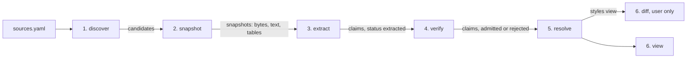

# How the pipeline works

This is the walk-through: what each step does, in the order it runs, with
what it reads and what it writes. The finer rules behind each step are in
[plan/design.md](plan/design.md), and how the result is scored is in
[plan/evaluation.md](plan/evaluation.md).

The whole pipeline rests on one idea: **the model says where a value is,
and code checks that it is there.** A language model reads each document
and points at table cells and quotes. Nothing it says is believed until
`verify` finds the value at the place it pointed to, in the document as
fetched. Every value in the final catalogue can therefore be traced to a
document, a location in it, and a quote.

## At a glance



| Step | Command | Question it answers | Reads | Writes |
|---|---|---|---|---|
| 0. Configure | edit `sources.yaml` | what may be fetched, and where do we start? | | |
| 1. Discover | `just discover` | which documents exist? | listing pages | `candidates` |
| 2. Snapshot | `just snapshot` | what does each document say, byte for byte? | candidates | `snapshots`, files in `data/snapshots/` |
| 3. Extract | `just extract` | what does the model say is in each document, and where? | snapshots | `extractions`, `style_claims`, `value_claims` |
| 4. Verify | `just verify` | is each claim really at the place it names? | claims, snapshots | claim `status` and `reject_reason` |
| 5. Resolve | `just resolve` | which styles exist, and what is each one's value per column? | admitted claims | `style_records`, `style_values`, `check_results`, views |
| 6. Score | `just diff dev` (user only) | how does the catalogue compare with OpenSpec? | `styles` view, the reference | detail file, feedback file |
| 6. Inspect | `just view` | what does the data look like, and why? | the database, snapshots, feedback | nothing |

`just run dev` runs steps 1 to 5 for the development year (2023);
`just run heldout` and `just run all` do the same for the other years.
Each stage also takes `--years 2022 2023` to work on some years only.

## Where things live

Everything the pipeline produces is under `data/` (set
`CAR_SURVEYOR_DATA_DIR` to move it):

```
data/
  surveyor.duckdb        every table below
  snapshots/             <sha256>.pdf|html|zip   the bytes as fetched
                         <sha256>.txt            the text derived from them
                         <sha256>.tables.json    the tables derived from them
  inbox/                 PDFs downloaded by hand, under their original file name
  extraction/            request and answer files, when extraction runs through files
  feedback/              what the diff may tell an agent: statuses and counts only
```

The database tables, in the order the stages fill them:

| Table | Filled by | One row per |
|---|---|---|
| `candidates` | discover | address found, fetched or not |
| `snapshots` | snapshot | document held (address plus capture) |
| `extractions` | extract | document read by one extractor version, with the raw answer and its cost |
| `style_claims` | extract, settled by verify | priced row a document prints |
| `value_claims` | extract, settled by verify | value a document states |
| `style_records` | resolve (rebuilt each run) | style |
| `style_values` | resolve (rebuilt each run) | admitted claim attached to a style |
| `check_results` | resolve | consistency finding |

The views in `sql/views.sql` sit on top: `styles` (the catalogue, one row
per style with the chosen value of each column), `disagreements` and
`coverage`.

## Step 0: Configure

**File:** `sources.yaml`. **Code:** `source.py` (`Registry`).

The registry is the only place that says what the pipeline may touch. It
holds:

- **The slice:** make (`Toyota`), market, model years 2020 to 2025, and the
  development year (2023).
- **Sources:** each site, the hosts that belong to it, and its *route*.
  `direct` means the pipeline fetches it itself, with a crawl delay
  (10 seconds for the pressroom, as its `robots.txt` asks). `archive`
  means the host refuses non-browser clients, so its documents come from
  the Wayback Machine or from a hand download.
- **Listings:** the pages discovery starts from. For Toyota these are the
  pressroom's vehicle sitemap and its full-line pricing page.
- **Fixed documents:** documents at a known address, which need no
  discovery. Here, the EPA's `vehicles.csv.zip`.

The fetcher refuses any address whose host is not in the registry, so
adding a source is a reviewed change to this one file.

## Step 1: Discover — finding the documents

**Command:** `just discover`. **Code:** `discovery.py`, `source.py`.
**Output:** the `candidates` table.

Discovery builds the list of documents worth reading. It never guesses an
address: a candidate exists because a fetched page linked to it, or
because the registry names it.

1. **Record the fixed documents.** `vehicles.csv.zip` goes in as a
   candidate of kind `fuel_economy_file`.
2. **Read the vehicle sitemap.** Every `<loc>` address in it that has the
   form `/vehicle/<year>-toyota-<model>` and a model year in the slice is
   recorded as a `vehicle_page` candidate, for example
   `/vehicle/2023-toyota-camry`.
3. **Read the full-line pricing page.** Every PDF it links to is recorded.
4. **Read each vehicle page** and record every PDF it links to. These pages
   are where each model's Product Information document is linked.
5. **Classify each link by its file name.** A PDF whose name contains
   `pricing` is a `pricing_pdf`; one whose name contains `Product Info` is
   a `product_information_pdf`; any other PDF is an `other_pdf`, recorded
   but never read. Links that are not PDFs, or that point to a host the
   registry does not list, are ignored.
6. **Give each candidate its model years.** A pricing document's years
   come from its link text or file name (`2023-2024 Toyota Full-Line
   Pricing` covers 2023 and 2024). Any other document takes the year of
   the vehicle page that links it.

Listing pages are stored as snapshots like any other fetch, so a second
run reads them from disk and makes no requests. Each candidate carries a
status, `pending`, `fetched` or `unavailable`, and `just status` counts
them by kind and status.

## Step 2: Snapshot — collecting the documents

**Command:** `just snapshot`. **Code:** `snapshot.py`, `fetcher.py`,
`document.py`. **Output:** the `snapshots` table and the files in
`data/snapshots/`.

Each candidate is fetched once, and its bytes are kept for good.

### 2a. Getting the bytes

Every request goes through `Fetcher`, the one place the pipeline touches
the network. Before each request, and each redirect, `check_address`
refuses the reference's domain, any host the registry does not list, any
non-HTTPS address, and any Wayback address that asks for something other
than a listed source's page. It waits out each source's crawl delay, names
the project in its user agent, never imitates a browser, and pauses a
minute after an HTTP 429.

How a document is reached depends on its source's route:

| Route | Used for | How |
|---|---|---|
| `direct` | pressroom pages, `vehicles.csv.zip` | fetched from its own address |
| `archive`, inbox | a PDF downloaded by hand | read from `data/inbox/<file name>` if present |
| `archive`, Wayback | Toyota's PDFs | ask the Wayback availability API for the closest capture, then fetch that capture's original bytes (the `id_` form, without the archive's banner) |

A Wayback capture that is not a PDF, or a document with no capture at all,
is marked `unavailable` with the reason. `just status --missing` lists
those, with the file name to save each under in `data/inbox/`.

Toyota updates price sheets in place at the same address, so
`just snapshot --every-capture` also asks the Wayback index for every
distinct capture of each held price sheet and keeps each one it does not
hold, with its own capture date. Its prices become dated values beside the
others.

### 2b. Deriving text and tables

When the bytes are stored, text and tables are derived from them
(`document.derive_document`):

- **PDF:** the text of each page, pages joined by a form feed, and each
  table as a grid of cells. Tables are read from where each word sits on
  the page, not from the lines the PDF draws, because Toyota's tables
  draw their column rules in the header only and continue across pages
  without a header.
- **HTML:** the visible text and the tables.
- **ZIP:** the text of the file inside (`vehicles.csv`).

Nothing is cleaned or reordered: verification later computes locations in
this text, and a cleaned text would move them. Because the bytes are kept,
the derivation can be redone at any time without fetching:
`just snapshot --rederive`.

A snapshot has three dates that are never merged: `fetched_at` (when the
pipeline got it), `capture_date` (the archive's timestamp), and
`document_date` (what the document says about itself, filled in by
extract, and only when code finds the statement).

## Step 3: Extract — reading the documents

**Command:** `just extract`. **Code:** `extraction.py`, `claim.py`,
`prompts/`. **Output:** the `extractions`, `style_claims` and
`value_claims` tables.

Extract turns each document into *claims*: statements of the form "this
document says X, here". It reads each document once per extractor
version, and keeps the answer exactly as returned.

### What is read, and how

| Kind | Reader | Prompt | What comes out |
|---|---|---|---|
| `fuel_economy_file` | a CSV parser, no model | | three mpg claims per row of the registry's make and years |
| `pricing_pdf` | a model | `prompts/pricing-v1.md` | one style claim and one MSRP claim per priced row, one claim per delivery fee |
| `product_information_pdf` | a model | `prompts/specification-v1.md` | one claim per horsepower, torque or mpg figure |
| `other_pdf`, `vehicle_page` | not read | | |

For a model-read document, `build_request` lays the snapshot out page by
page: each page's text, then each of its tables with cells separated by
` | ` and labelled by page and index. The prompt is the system message,
and the answer is constrained to a JSON schema (`PricingAnswer` or
`SpecificationAnswer`). The prompts tell the model to copy, not recall: to
return cells and quotes exactly as printed, null for anything not printed,
and errors in the document as they are.

There are two ways to run the model:

- **Through the API** (default): `AnthropicExtractor`, one streamed call
  per document. The default model is Claude Haiku 5.5 with thinking off,
  and by default only price sheets are read this way.
- **Through files:** `just extract --export data/extraction --label <name>`
  writes each pending request to a file, something else (a Claude Code
  agent running Opus, say) writes an answer file beside it, and
  `just extract --import data/extraction --label <name>` reads them back.
  Spec sheets are read this way, because Haiku located their figures too
  poorly ([comparison](findings/2026-11-16-haiku-vs-opus-extraction.md)).

Either way the answer passes the same schema and the same verification.
An answer that does not fit the schema is kept as `failed` and yields no
claims.

### What a claim holds

- **A style claim** is one priced row: model year, model code, the
  description as printed, and the description split into model,
  powertrain, grade, drive, engine, transmission and body. Its *locator*
  is a table cell: page, table, row label, column header.
- **A value claim** is one value: the attribute, the value as printed and
  as a number, the unit, a quote, a locator, any hedges (`estimated`,
  `up to`), qualifiers (whether an MSRP includes the delivery fee), and an
  effective date. It either names one style (an MSRP names its row) or
  says what it applies to in the document's own words, in `applies_to`: a
  delivery fee lists models, a horsepower figure lists grades and an
  engine, an EPA row is named `Camry AWD LE/SE`.

Each style claim gets a `style_key`: the model year and Toyota's model
code where the code is unique in the document, or else the model year and
the description's parts. That key is how the same style seen in two
documents is recognised as one.

### Versions and re-reading

An answer is keyed on the snapshot's hash and the *extractor version*,
which is the extractor's label plus the prompt's name, for example
`claude-haiku-5-5/no-thinking+pricing-v1`. A second run finds the answer
and makes no call. A changed prompt is a new file with a new name, so its
answers never mix with the old one's.

## Step 4: Verify — checking each claim

**Command:** `just verify`. **Code:** `verification.py`, `evidence.py`.
**Output:** each claim's `status` becomes `admitted` or `rejected`, with a
`reject_reason`.

Verify is what makes a model's answer safe to use. It works in two layers.

**`evidence.py` finds the place.** It looks a table cell up by its row
label and column header in the derived tables, finds a quote in the text,
or finds a row and column in the CSV. Numbers are compared as numbers, so
`495` does not pass inside `$28,495`. A row label that fits two different
rows names neither.

**`verification.py` decides whether the place is the right one.** Each
kind of claim has its own rule:

| Claim | Admitted only when |
|---|---|
| style | the description is the located cell, the model code and year are in that row, and every word of model, grade and the other parts is printed in the description |
| MSRP | the cell is under a header naming a price, holds a dollar amount, and is on the row of an admitted style |
| delivery fee | its quote is a dollar amount, with its vehicle class and every listed model printed after it |
| specification figure | the quote is found, gives that number in the claim's unit (`203 hp @ 6,600 rpm` gives 203 hp, not 6,600), and any hedge printed with it is recorded |
| EPA figure | it is the attribute's own column of a row with the right make and model year |

A document's own date is admitted the same way: only when its quote is in
the text and states that day, month and year.

After a change to how documents are read or checked,
`just verify --recheck` sets every claim back to `extracted` and checks it
again.

## Step 5: Resolve — from claims to a catalogue

**Command:** `just resolve`. **Code:** `resolution.py`, `consistency.py`,
`sql/views.sql`. **Output:** `style_records`, `style_values`,
`check_results`, and the views. Rebuilt from the admitted claims on every
run.

### 5a. Build the styles

A style exists only if a pricing document prints a row for it. Admitted
style claims that share a `style_key` are merged into one style, which
takes its words from the latest document. Each style's drive and
transmission are put into classes (`4x4`, `AWD` and `AWD-e` are all
four-wheel; `6MT` is manual).

### 5b. Infer from the rows beside it

Three things are inferred, and only when the neighbouring row exists:

- `Camry LE` printed beside `Camry LE AWD` is not all-wheel drive.
- `3.0 Base` printed beside `3.0 Base MT` is the automatic. Where a line's
  rows mark only manuals, an unmarked row is the automatic.
- `SR Access Cab 6AT` beside `SR Access Cab V6 6AT` is not a V6.

What is inferred is flagged as inferred.

### 5c. Attach each value to the styles it applies to

- **MSRP** attaches to the style its row named.
- **Delivery fee** attaches to styles priced in the same document whose
  line is in the fee's list of models.
- **Horsepower and torque** come from the Product Information document
  whose title covers the style's line. Each figure's scope (grades,
  drive, engine column, powertrain words such as `Gas` against `Hybrid`)
  is matched against the style.
- **Fuel economy** from the EPA file attaches when every word of the
  row's name after the model is accounted for by the style, and its
  drive, transmission, cylinders and displacement do not contradict it.

The rules: a claim that contradicts the style is not attached (what the
style does not print is unknown, and unknown does not contradict), and
each attachment is given a specificity, so a figure that names the
style's grade outranks one given for a whole column.

### 5d. Choose one value per cell

- **MSRP and delivery fee** are dated: the latest stands, and earlier
  values are kept as history.
- **Everything else** goes by agreement among the most specific claims.
  If they state one value, that is the cell. If they state several, the
  cell is left empty and listed in `disagreements`, unless another
  source states exactly one of them. For fuel economy the EPA file ranks
  above Toyota's documents.

An empty cell means either that no document states the value, or that the
documents disagree. The `coverage` view counts the two apart. Nothing is
ever filled with a default.

### 5e. Consistency checks

Checks look across styles for patterns that suggest a reading error. They
never change a value; they write findings to `check_results`.

| Check | Flags |
|---|---|
| `drive_price_order` | a four-wheel-drive style priced below its otherwise identical two-wheel-drive style |
| `year_over_year_price` | a model code whose price moved more than 15% up or 5% down between model years |
| `fuel_economy_agreement` | a Toyota mpg figure that differs from the EPA file's |
| `repeated_model_code` | one model code on rows a document describes differently |
| `repeated_description` | one description priced twice in a document, at different prices |

## Step 6: Score and inspect

**Diff** (`just diff dev`, `diff.py`, `reference.py`) is run by the user
only, from their own terminal. It matches the reference's configurations
to the pipeline's styles, first by model year and model code, then by
description, and compares each column. It writes a detail file with both
sides' values outside the repository, and a feedback file in
`data/feedback/` with only statuses and counts, which is all an agent may
see. See [plan/evaluation.md](plan/evaluation.md) and
[plan/isolation.md](plan/isolation.md).

**View** (`just view`, `viewer.py`) serves a read-only local page over
the database: the catalogue, each cell's claims with the quote
highlighted in its document, the documents and what became of them, the
checks, and the diff's feedback.

## Re-running

Every stage is idempotent: a second run makes no requests and no model
calls, and leaves every table as it was. The flags that deliberately redo
work:

| Flag | Redoes |
|---|---|
| `--retry-unavailable` (discover, snapshot) | asks again for what an earlier run could not get |
| `snapshot --every-capture` | fetches archived captures of price sheets not yet held |
| `snapshot --rederive` | derives text and tables again from stored bytes, no fetching |
| `extract --retry-failed` | calls the model again for documents whose extraction failed |
| `verify --recheck` | checks every claim again |

`resolve` always rebuilds its tables from scratch.

## Where Toyota is built in

The stages themselves are general: a registry, a polite fetcher,
immutable snapshots, a model that points, code that checks, and a
resolver that never invents. The knowledge of Toyota sits in particular
places. Knowing where matters for two reasons: they are what a second
make would have to replace, and they are where the pipeline may be fitted
to the documents it was built on.

| Step | General | Specific to Toyota or to these documents |
|---|---|---|
| Configure | registry, routes, crawl delays | the listings and hosts in `sources.yaml` |
| Discover | link collection, sitemap reading, candidate tracking | the vehicle page pattern `/vehicle/<year>-toyota-<model>` (`source.py`); classifying PDFs by the words `pricing` and `Product Info` in their file names; pricing documents' years read from their file names |
| Snapshot | fetching, Wayback fallback, inbox, hashing | only price sheets are re-captured (`DATED_KINDS`) |
| Derive | PDF text, HTML, ZIP | the table reader's handling of header-only column rules, continued tables, and header cells spanning columns was built for Toyota's layouts |
| Extract | request and answer handling, schema, versions | both prompts name Toyota and give Toyota examples (grades, `5ECT`, `CrewMax`); the pricing schema assumes one table per price list with model code, model year, description and MSRP columns |
| Verify | evidence lookup, number comparison | price headers recognised by `msrp` or `price`; the list of hedge words; a fee's models searched within 600 characters after its amount |
| Resolve | attach, rank, choose by agreement | the most Toyota-specific step: drive words (`AWD-e`, `AWD-i`), grade abbreviations (`PLTM`, `TRD-ORP`, `NS`), words that make a separate line (`Hybrid`, `Prime`, `Cross`, `GR`, `Crown`, `MAX`), the sibling inferences, matching Product Information documents to lines by title, and fuel economy row names |
| Checks | the checks themselves | the 15% / 5% year-over-year band |
| Diff | | matching by model code relies on Toyota printing a unique code per style |

One more point bears on fitting. The held-out split keeps the
*reference* for 2020 to 2022, 2024 and 2025 unseen, but the rules above
were written while reading the *documents* of every year: the all-years
run ([findings](findings/2026-11-16-all-years.md)) changed the code to
handle cases found in held-out years' PDFs. The held-out score will
therefore measure how well the rules fit OpenSpec on unseen years, not
how well they carry to documents they were not written against. Only the
2023 figures were checked row by row.
